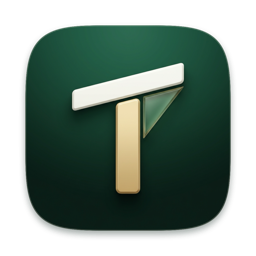
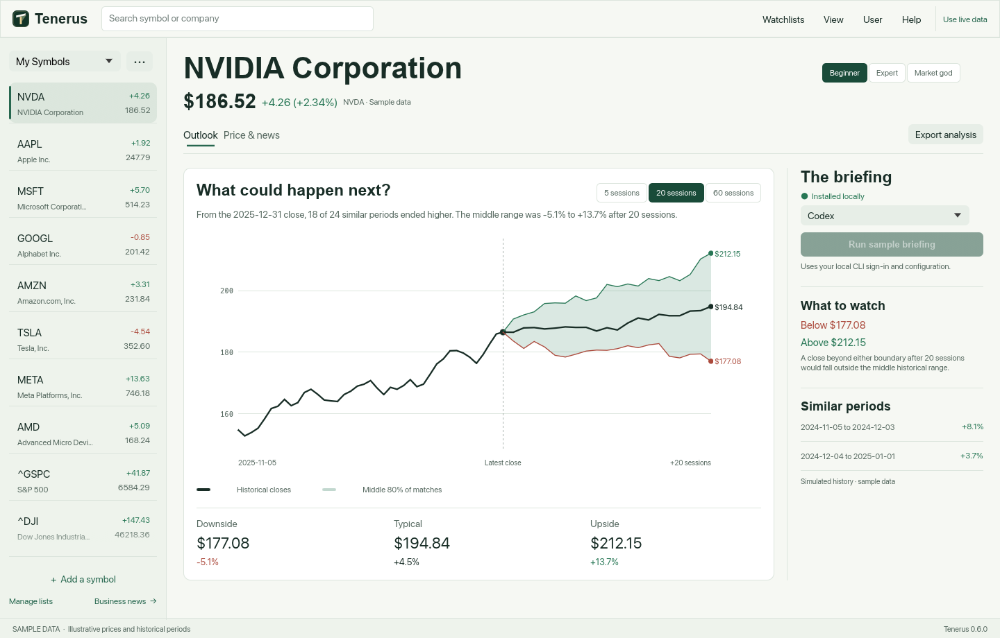
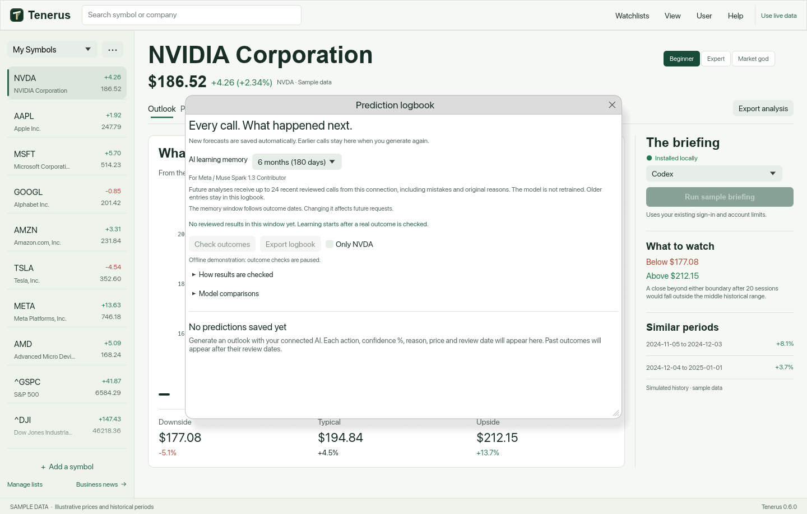
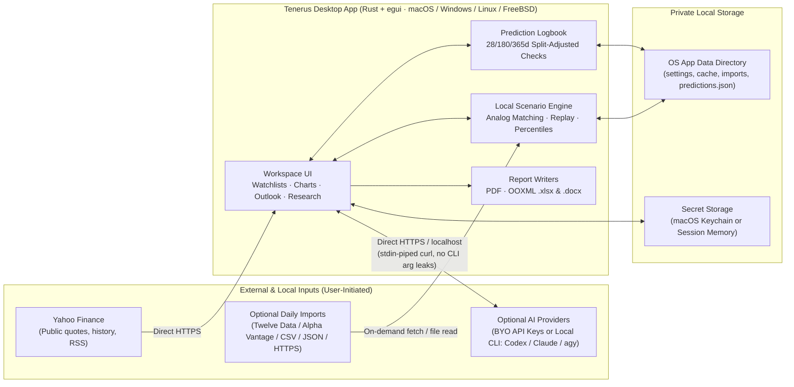
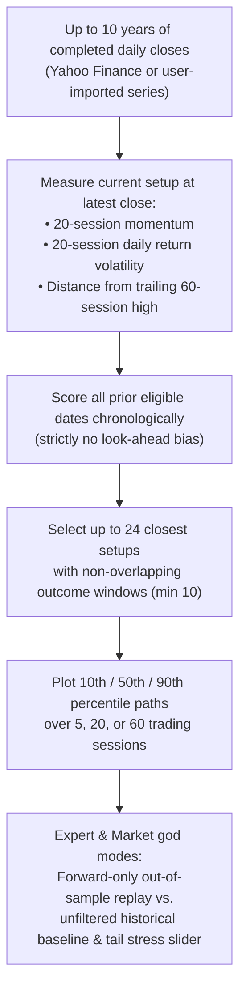

<div align="center">
  
  <h1>Tenerus</h1>
  <p><strong>A local-first native desktop market research &amp; historical scenario workspace built in Rust — for macOS, Windows, Linux, and FreeBSD.</strong></p>
  <p>
    <a href="https://github.com/bnelabs/tenerus/releases"></a>
    
    
    <a href="LICENSE"></a>
    
  </p>
</div>

> [!CAUTION]
> **SOLELY FOR EDUCATIONAL AND RESEARCH PURPOSES — NOT FOR REAL TRADING OR INVESTING.**
>
> Tenerus is an independent educational workspace for studying historical price patterns, inspecting how statistical ranges behave out-of-sample, and evaluating AI reasoning against transparent baselines. **Nothing in Tenerus is financial advice, an investment recommendation, or an offer to buy or sell any security.** Market data may be delayed, incomplete, or inaccurate; historical analogues and AI confidence scores do not predict future returns. Tenerus has no brokerage integration and cannot place orders. **Do not use Tenerus for real investment or trading decisions.**

<p align="center">
  
  <br />
  <sub><em>Tenerus Outlook (Offline demonstration mode with clearly labeled illustrative sample data).</em></sub>
</p>

---

## What is Tenerus?

Named after **Tenerus**—the prophetic demigod son of Apollo in Greek mythology—Tenerus is a fast, native desktop application for **macOS, Windows (x86_64 & ARM64), Linux (Ubuntu, Fedora, Arch — x86_64 & ARM64), and FreeBSD** built to **explore market history, compare price setups, and audit AI-assisted market commentary** entirely locally.

Instead of presenting opaque "price predictions," Tenerus focuses on **transparent historical context and accountability**:

- **See what followed similar market conditions:** Compare a ticker's current momentum, volatility, and drawdown against up to 10 years of completed daily closes to plot the 10th, 50th, and 90th percentile outcomes.
- **Test models against reality, not hype:** Every AI outlook is logged locally with its reference price, reasoning, and subjective confidence %, then automatically checked against actual split-adjusted closes at **28, 180, and 365 days** and benchmarked against naive **Always BUY / Always SELL / Always WAIT** baselines.
- **Keep everything local:** Watchlists, imports, logs, and settings stay on your device. There are no Tenerus backend servers, accounts, or telemetry.

---

## Key Features

| Area | What it does |
| --- | --- |
| **Outlook (Historical Scenarios)** | Matches up to 24 non-overlapping historical periods across **5, 20, or 60 trading sessions** with three depth levels: **Beginner** (percentile fan), **Expert** (out-of-sample accuracy vs. unfiltered history), and **Market god** (historical date replay + return stress-test slider). |
| **Price, Charts & News** | Multi-watchlist sidebar with drag-to-reorder and per-list sorting, 11 chart ranges (`1D`–`ALL`), volume & extended-hours toggles, optional fundamentals, public publisher headlines, saved stories, and tentative `.ics` earnings calendar export. |
| **Local Assistant Briefings** | Run structured, evidence-cited briefings directly through locally installed CLIs (**Codex**, **Claude Code**, or **Antigravity**) using any valid CLI sign-in or API-key auth you configured locally. |
| **Bring-Your-Own AI Research** | Connect directly to **OpenAI, Anthropic, Google, Grok · xAI, DeepSeek, NVIDIA, Meta**, or any **Custom / localhost** endpoint (4 API protocols supported) for structured short (1–4w), medium (3–6m), and long (1–3y) research cards. |
| **Prediction Logbook & Memory** | Append-only local `predictions.json` audit log with split-adjusted outcome reviews, fixed-action baseline comparisons, JSON export, and an optional rolling memory window (Off / 90 / 180 / 365 days) that supplies recent reviewed outcomes as prompt context (not model retraining). |
| **Custom Data Imports & Exports** | Import up to 4,000 daily closes per ticker from **Twelve Data**, **Alpha Vantage**, local **CSV/JSON** files, or a custom HTTPS/localhost endpoint. Export Outlook or AI research reports to **Excel (`.xlsx`)**, **PDF (`.pdf`)**, or **Word (`.docx`)** on every supported OS, with timestamps and educational-use notices. |

---

## Visual Walkthrough

<table>
  <tr>
    <td width="50%">
      
      <br />
      <strong>Price, Charts &amp; AI Research</strong> — Interactive <code>1D</code>–<code>ALL</code> charts, extended-hours and volume controls, fundamentals, and structured short/medium/long-term AI research cards.
    </td>
    <td width="50%">
      
      <br />
      <strong>Historical Replay &amp; Stress Testing</strong> — Pick a past trading date, inspect the range estimated using only prior history, reveal what actually happened, and stress-test tail returns.
    </td>
  </tr>
  <tr>
    <td width="50%">
      
      <br />
      <strong>Bring Your Own Intelligence</strong> — Configure OpenAI, Anthropic, Google, Grok · xAI, DeepSeek, NVIDIA, Meta, or localhost endpoints with zero plaintext secret files.
    </td>
    <td width="50%">
      
      <br />
      <strong>Prediction Logbook &amp; Baselines</strong> — Audit every AI call at 28/180/365 days, compare against Always BUY/SELL/WAIT baselines, and control rolling context memory.
    </td>
  </tr>
</table>

<details>
  <summary><strong>View About Dialog &amp; First-Launch Educational Disclaimer Gate</strong></summary>
  <br />
  <table>
    <tr>
      <td width="50%">
        
        <br />
        <sub><em><strong>About Tenerus</strong> — Displays version, OS/architecture, educational-use notice, and data boundaries.</em></sub>
      </td>
      <td width="50%">
        
        <br />
        <sub><em><strong>First-Launch Gate</strong> — Users must review and accept the educational-use terms before entering the workspace.</em></sub>
      </td>
    </tr>
  </table>
</details>

---

## How It Works

### 1. Local-First Cross-Platform Architecture & Data Boundaries

Tenerus runs natively in Rust on **macOS, Windows, Linux, and FreeBSD** with **no intermediary Tenerus server**. All calculations, OpenGL/egui rendering, scenario matching, logbook scoring, and report generation happen locally on your device.



### 2. How Historical Scenarios (*Outlook*) Are Calculated

Outlook does **not** run a black-box neural price predictor—it runs a deterministic, inspectable historical analogue calculation on completed daily closes:



- **Zero look-ahead leakage:** In *Expert* and *Market god* historical replays, every simulated date can only use historical outcomes that had already finished before that date.
- **Non-overlapping matches:** Comparable windows cannot overlap each other's outcome periods, preventing a single volatile month from being counted ten times.
- **Explicit data provenance:** Every chart, briefing, and exported report labels whether it used public feeds, imported daily closes, or offline simulated sample data.

### 3. How the Prediction Logbook & Rolling Memory Work

When you explicitly request an AI research outlook under **Price & news**, Tenerus requires structured `BUY`, `SELL`, or `DO NOT BUY` actions plus a numeric `0–100%` subjective confidence across three horizons:

1. **Immutable logging:** Each horizon decision is appended atomically to local `predictions.json` with its original text, provider/model, reference price, and fixed checkpoints (**28, 180, and 365 days**).
2. **Split-adjusted verification:** Once a checkpoint passes, Tenerus fetches the first completed daily close on or within 7 days after the checkpoint and aligns splits on the same basis (excluding dividends, fees, stale reference quotes, wrong currencies, and sample data).
3. **Transparent scoring rule:** `BUY` is marked right above `+2%`, `SELL` below `−2%`, and `DO NOT BUY` at or below `+2%`. Results are displayed side-by-side against **Always BUY / Always SELL / Always WAIT** on the exact same cohort.
4. **Prompt context, not retraining:** If learning memory is enabled (default 180 days), up to 24 recent reviewed outcomes for the same provider/model/endpoint are included as text context in your next request so you can study whether feedback changes reasoning. **No model weights are trained or fine-tuned.**

---

## Educational Use Only — Important Limitations

Tenerus is built strictly as a **learning and research instrument**. Please keep these boundaries in mind:

- **Not financial advice:** Neither the developer, historical scenario percentiles, nor any connected AI model provides personalized financial, legal, or tax advice.
- **No trade execution:** Tenerus does not connect to brokerages, manage portfolios, or execute orders.
- **Past analogues do not predict the future:** Market regimes shift, earnings surprise, and tail events break historical ranges. Percentile bands describe past frequencies only.
- **Simple direction scores ≠ profitability:** The logbook's ±2% price-direction rule ignores dividends, slippage, taxes, position sizing, and correlated overlapping windows.
- **AI models make mistakes:** Connected LLMs can hallucinate, misread context, or display overconfident percentages. Treat AI outputs as hypotheses to verify against primary filings and disclosures.
- **Data & AI provider terms apply:** Yahoo Finance quote/chart/RSS requests use **unofficial, unaffiliated public web endpoints** intended strictly for personal educational study and may be delayed, incomplete, rate-limited, or unavailable at any time. Optional data feeds (Twelve Data, Alpha Vantage), AI APIs, and local CLI assistants remain governed by each provider's respective terms of service.

---

## Download & Install

Prebuilt packages for every platform are published on [**GitHub Releases**](https://github.com/bnelabs/tenerus/releases) alongside a unified `SHA256SUMS.txt` checksum file.

| Platform | Architecture | Package Format | Install / Run |
| --- | --- | --- | --- |
| **macOS** (13+) | Apple Silicon (`arm64`) | `Tenerus-<ver>-macos-arm64.zip` | Unzip `Tenerus.app` into `/Applications` (or a regular local folder) and open it. |
| **Windows** (10/11) | `x86_64` & `ARM64` | `Tenerus-<ver>-windows-x86_64.zip`<br/>`Tenerus-<ver>-windows-arm64.zip` | Unzip and run `tenerus.exe`. Uses built-in Windows `curl.exe`—no extra runtime needed. |
| **Ubuntu / Debian** | `amd64` & `arm64` | `tenerus_<ver>_amd64.deb`<br/>`tenerus_<ver>_arm64.deb` | `sudo apt install ./tenerus_<ver>_<arch>.deb` |
| **Fedora / RHEL** | `x86_64` & `aarch64` | `tenerus-<ver>-1.*.x86_64.rpm`<br/>`tenerus-<ver>-1.*.aarch64.rpm` | `sudo dnf install ./tenerus-<ver>-1.*.<arch>.rpm` |
| **Arch Linux** | `x86_64` & `aarch64` | `tenerus-<ver>-1-x86_64.pkg.tar.zst`<br/>`tenerus-<ver>-1-aarch64.pkg.tar.zst` | `sudo pacman -U ./tenerus-<ver>-1-<arch>.pkg.tar.zst` *(or build with [`packaging/arch/PKGBUILD`](packaging/arch/PKGBUILD))* |
| **Linux (Portable)** | `x86_64` & `arm64` | `tenerus-<ver>-linux-x86_64.tar.gz`<br/>`tenerus-<ver>-linux-arm64.tar.gz` | Extract and run `./bin/tenerus` (requires `curl` and OpenGL/X11 or Wayland). |
| **FreeBSD** (14+) | `amd64` | `tenerus-<ver>-freebsd-amd64.pkg`<br/>`tenerus-<ver>-freebsd-amd64.tar.xz` | `sudo pkg add ./tenerus-<ver>-freebsd-amd64.pkg` *(or extract `.tar.xz` and run `./bin/tenerus`)* |

Verify any download against `SHA256SUMS.txt`:
```sh
# Linux / macOS
shasum -a 256 --ignore-missing -c SHA256SUMS.txt

# FreeBSD
sha256 -c SHA256SUMS.txt
```

> [!NOTE]
> **Platform Notes:**
> - **Signing:** Community macOS builds are locally ad-hoc signed (`codesign --sign -`) and Windows binaries are unsigned. Gatekeeper / SmartScreen may prompt for confirmation on first run; you can also build from source below.
> - **Local data directories:**
>   - **macOS:** `~/Library/Application Support/Tenerus`
>   - **Windows:** `%APPDATA%\Tenerus`
>   - **Linux & FreeBSD:** `$XDG_DATA_HOME/tenerus` (defaults to `~/.local/share/tenerus`)
> - **Exports & Secret Storage:** Excel (`.xlsx`), PDF (`.pdf`), and Word (`.docx`) exports work on all platforms (native Save dialog on macOS; saved to `<data_dir>/exports/` on Windows, Linux, and FreeBSD). API secrets can optionally be saved in **macOS Keychain** on macOS and remain session-only in memory on Windows, Linux, and FreeBSD.

---

## Build & Run from Source

### Prerequisites
- **Rust 1.85+** (Rust 2024 edition) via [rustup](https://rustup.rs/)
- **System dependencies:**
  - **macOS:** Xcode Command Line Tools
  - **Windows:** Visual Studio Build Tools (MSVC)
  - **Ubuntu / Debian:** `sudo apt install pkg-config libgl1-mesa-dev libx11-dev libxkbcommon-dev libwayland-dev curl`
  - **Fedora:** `sudo dnf install gcc pkgconf-pkg-config mesa-libGL-devel libX11-devel libxkbcommon-devel wayland-devel curl`
  - **Arch Linux:** `sudo pacman -S base-devel libgl libx11 libxkbcommon wayland curl`
  - **FreeBSD:** `sudo pkg install rust curl pkgconf mesa-libs libX11 libxkbcommon wayland`

### Build, Test & Package

```sh
git clone https://github.com/bnelabs/tenerus.git
cd tenerus

# Run the full test suite (124 unit & headless UI tests)
cargo test

# Launch in offline demonstration mode (labeled sample data)
cargo run -- --demo

# Build release binary
cargo build --release
```

Platform packaging scripts included in `scripts/`:
- macOS: `sh scripts/package.sh`
- Windows: `pwsh ./scripts/package-windows.ps1 -BinaryPath target/release/tenerus.exe -Arch x86_64`
- Ubuntu `.deb`: `sh scripts/package-linux-deb.sh target/release/tenerus amd64`
- Fedora `.rpm`: `rpmbuild -bb --define "_version 0.6.0" --define "_bin $(pwd)/target/release/tenerus" --define "_root $(pwd)" packaging/linux/tenerus.spec`
- Arch Linux: `cd packaging/arch && makepkg -si`
- FreeBSD `.pkg` & `.tar.xz`: `sh scripts/package-freebsd.sh target/release/tenerus amd64`

### Useful CLI Options

| Flag / Env Var | Description |
| --- | --- |
| `--demo` | Launch in offline demonstration mode with labeled simulated prices. |
| `--symbol AAPL` | Open directly on a specific ticker without adding it to watchlists. |
| `--watchlist 1` | Open a specific local watchlist scrolled to the top. |
| `--business-news` | Open market-wide headlines. |
| `--screenshot <file.png> --view <name>` | Render 120 frames off-focus (`prices`, `expert`, `market-god`, `connections`, `news`, `saved`, `logbook`, `models`, `welcome`, `about`, `help`, `disclaimer`, `import-data`), save PNG, and exit. |
| `--check-local-model` | Read-only hardware & Python/MLX/TimesFM readiness check (installs/downloads nothing). |
| `--test-briefing <codex\|claude\|agy>` | Validate a local CLI assistant using sample scenario evidence. |
| `TENERUS_DATA_DIR=/path` | Override the default OS data directory. |

---

## Security & Privacy Highlights

- **Local storage only:** Settings, watchlists, imported closes, cached feeds, and `predictions.json` stay on your device using atomic writes (`0600` files inside `0700` directories on Unix).
- **No plaintext secrets on disk:** API keys remain in memory unless you opt into **macOS Keychain** (`Tenerus inference`) on macOS. Secrets are never written to settings files or exported reports.
- **Safe HTTP transport:** Remote endpoints require HTTPS with explicit curl `proto` locking (HTTP is restricted to `localhost`/loopback, which automatically bypasses system HTTP proxies via `noproxy = "*"`). Headers and credentials are piped to the OS-trusted `curl` binary over `stdin` so keys never appear in process listings or get hijacked from the working directory.
- **Hardened release supply chain:** All GitHub Actions are pinned to immutable commit SHAs on Node.js 24 with deny-by-default token permissions (`permissions: {}`) and `persist-credentials: false`. See [SECURITY.md](SECURITY.md) for the full threat model and vulnerability reporting process.

---

## Changelog, Credits & License

- **Release history:** See [CHANGELOG.md](CHANGELOG.md) and [GitHub Releases](https://github.com/bnelabs/tenerus/releases).
- **Third-party licenses & data boundaries:** See [CREDITS.md](CREDITS.md).
- **License:** Released under the [MIT License](LICENSE).
