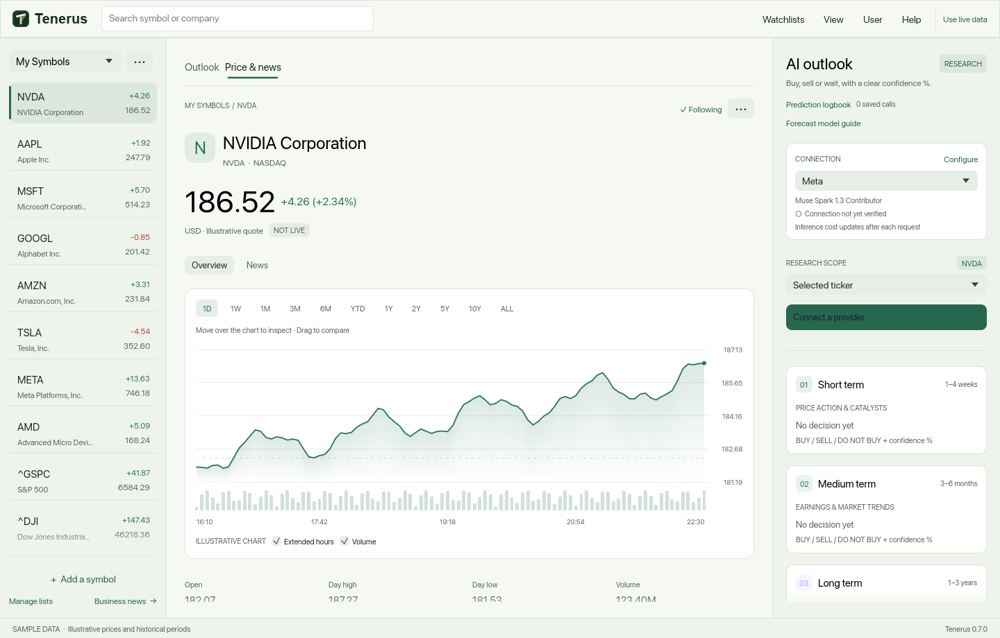
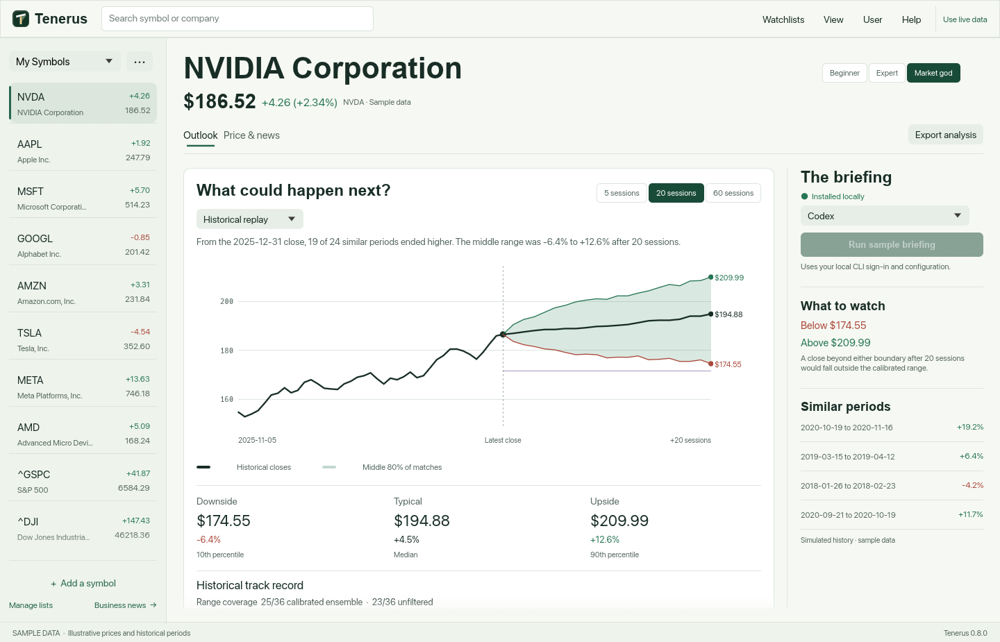
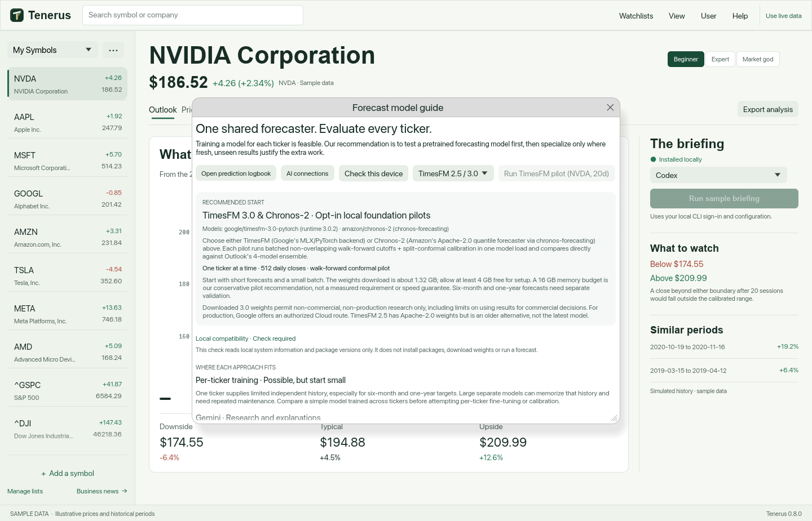
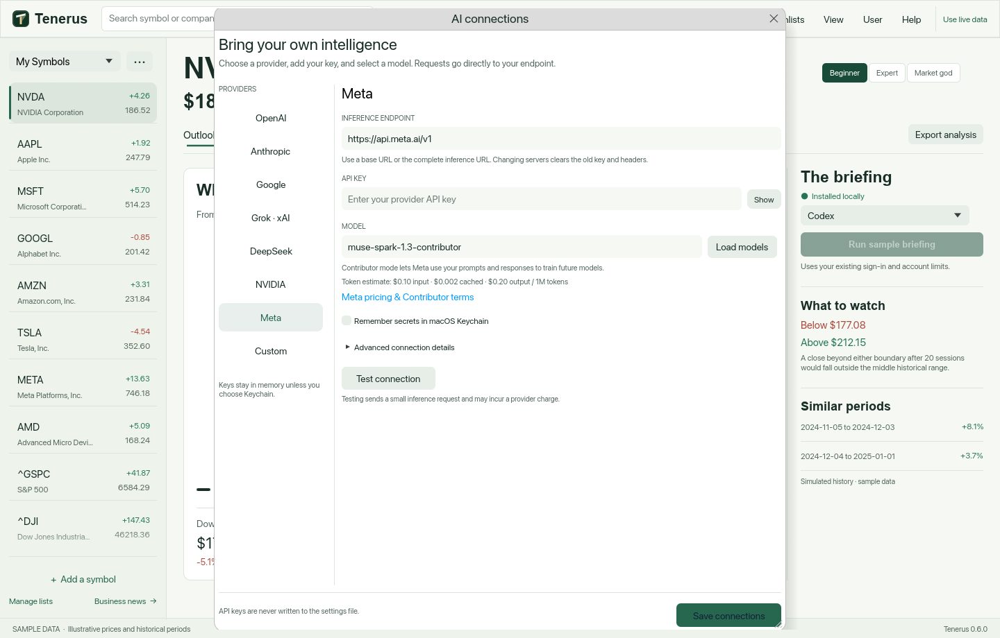
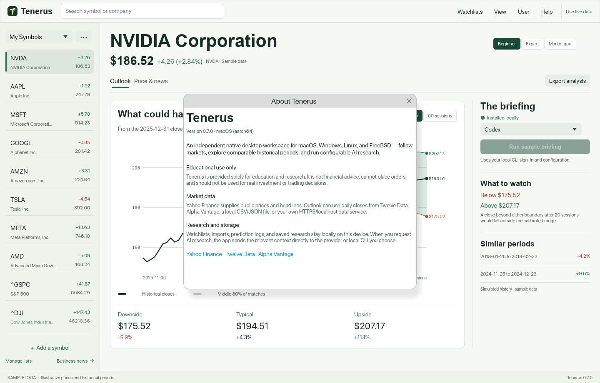
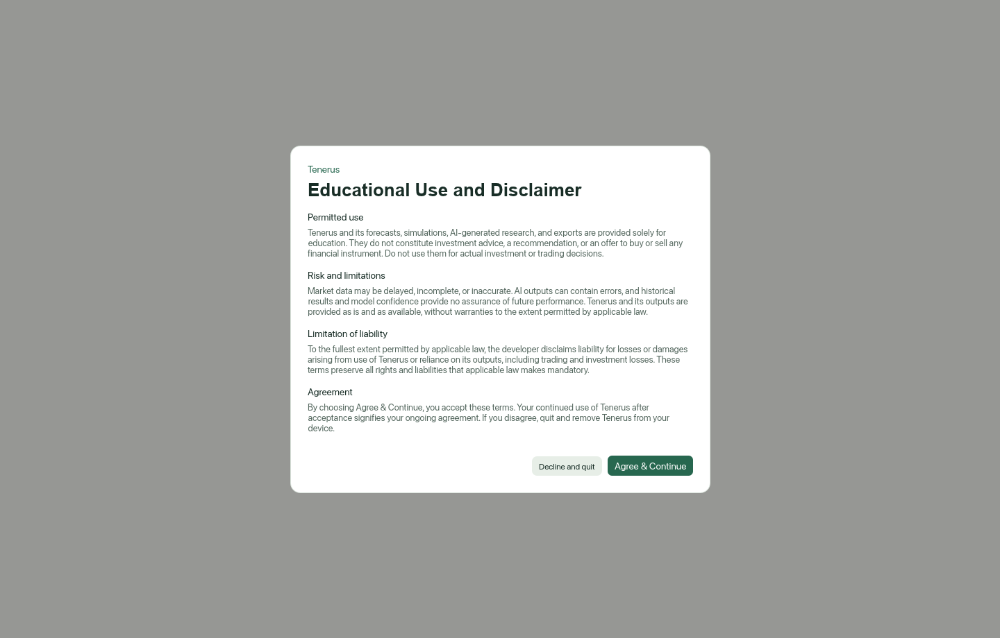
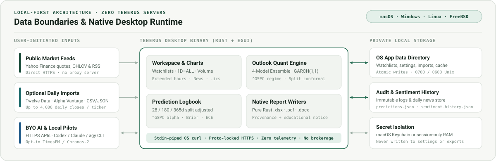
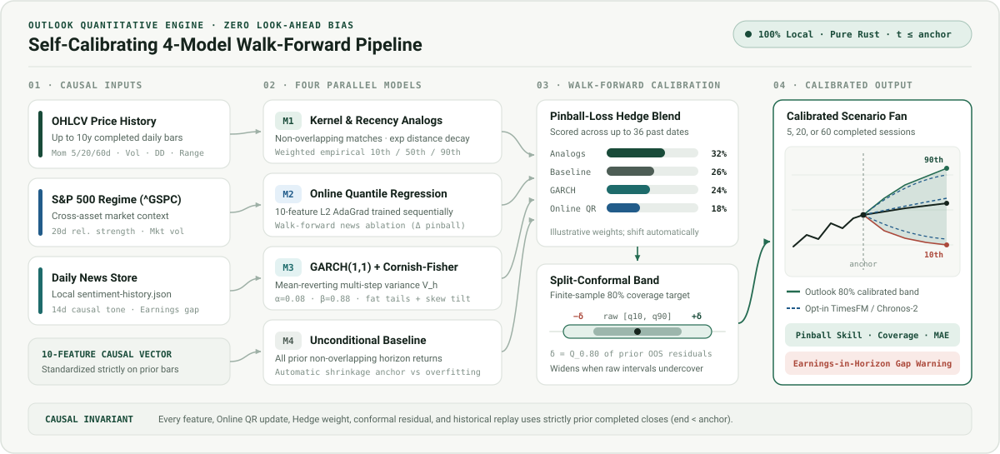

<div align="center">
  
  <h1>Tenerus</h1>
  <p><strong>A local-first native desktop market research &amp; self-calibrating scenario workspace in Rust — for macOS, Windows, Linux, and FreeBSD.</strong></p>
  <p>
    <a href="https://bnelabs.github.io/tenerus/"></a>
    <a href="https://bnelabs.github.io/tenerus/demo.html"></a>
    <a href="https://github.com/bnelabs/tenerus/releases"></a>
    
    
    <a href="LICENSE"></a>
    
  </p>
  <p>
    <a href="#why-tenerus">Why Tenerus</a> ·
    <a href="#visual-tour">Visual Tour</a> ·
    <a href="#how-it-works">How It Works</a> ·
    <a href="#download--install">Download</a> ·
    <a href="#build--run-from-source">Build</a> ·
    <a href="#security--privacy">Security</a>
  </p>
</div>

> [!CAUTION]
> **SOLELY FOR EDUCATIONAL AND RESEARCH PURPOSES — NOT FOR REAL TRADING OR INVESTING.**
>
> Tenerus is an independent educational workspace for studying historical price distributions, testing calibrated statistical ranges out-of-sample, and auditing AI-assisted market commentary against transparent baselines. **Nothing in Tenerus is financial advice, an investment recommendation, or an offer to buy or sell any security.** Market feeds may be delayed, incomplete, or inaccurate; historical analogues, foundation models, and AI confidence percentages do not predict future returns. Tenerus has no brokerage integration and cannot place orders. **Do not use Tenerus for real investment or trading decisions.**

<p align="center">
  
  <br />
  <sub><em>Tenerus Outlook in offline demonstration mode (clearly labeled illustrative sample data).</em></sub>
</p>

---

## Why Tenerus?

Named after **Tenerus**—the prophetic demigod son of Apollo in Greek mythology—Tenerus is a fast, native desktop workspace for **macOS, Windows (`x86_64` & `ARM64`), Linux (Ubuntu, Fedora, Arch — `x86_64` & `ARM64`), and FreeBSD (`amd64`)**.

Instead of presenting opaque price targets, Tenerus treats market analysis as a **falsifiable, strictly causal scientific workflow**:

<table>
  <tr>
    <td width="50%" valign="top">
      <strong>Self-Calibrating 4-Model Outlook</strong><br />
      Blends <em>Kernel/Recency Analogs</em>, <em>10-Feature Online Quantile Regression</em>, <em>Mean-Reverting GARCH(1,1)</em>, and an <em>Unconditional Baseline</em> using out-of-sample pinball-loss Hedge weights and split-conformal 80% calibration across 5, 20, or 60 sessions.
    </td>
    <td width="50%" valign="top">
      <strong>Cross-Asset Regime &amp; News Ablation</strong><br />
      Pulls S&amp;P 500 (<code>^GSPC</code>) relative strength and market volatility alongside a zero-dependency local headline scorer (<code>sentiment-history.json</code>), earnings-in-horizon gap warnings, and walk-forward ablation measuring whether stored news actually reduces error.
    </td>
  </tr>
  <tr>
    <td width="50%" valign="top">
      <strong>Prediction Logbook &amp; <code>^GSPC</code> Alpha</strong><br />
      Every AI decision is logged immutably to <code>predictions.json</code>, split-adjusted and checked at 28, 180, and 365 days, and scored against <strong>Always BUY / SELL / WAIT</strong> baselines, excess return vs. <code>^GSPC</code>, <strong>Brier Score</strong>, and <strong>Expected Calibration Error (ECE)</strong>.
    </td>
    <td width="50%" valign="top">
      <strong>Opt-In TimesFM &amp; Chronos-2 Pilots</strong><br />
      Run local <strong>TimesFM 2.5/3.0</strong> or <strong>Amazon Chronos-2</strong> Python pilots on demand: executes batched non-overlapping walk-forward cutoffs + split-conformal calibration in one load, scores apples-to-apples against Outlook, and overlays bounds on the chart.
    </td>
  </tr>
  <tr>
    <td width="50%" valign="top">
      <strong>Bring-Your-Own AI &amp; Local CLI Briefings</strong><br />
      Connect directly to <strong>OpenAI, Anthropic, Google, Grok · xAI, DeepSeek, NVIDIA, Meta</strong>, or custom/localhost endpoints—or trigger evidence-cited local briefings via installed <strong>Codex</strong>, <strong>Claude Code</strong>, or <strong>Antigravity</strong> CLIs.
    </td>
    <td width="50%" valign="top">
      <strong>Custom Imports &amp; Portable Reports</strong><br />
      Import up to 4,000 daily OHLCV bars per ticker from <strong>Twelve Data</strong>, <strong>Alpha Vantage</strong>, CSV/JSON, or custom HTTPS endpoints. Export Outlook or AI research to <strong>Excel (<code>.xlsx</code>)</strong>, <strong>PDF (<code>.pdf</code>)</strong>, or <strong>Word (<code>.docx</code>)</strong> on every OS.
    </td>
  </tr>
</table>

---

## Visual Tour

<table>
  <tr>
    <td width="50%">
      
      <br />
      <strong>Price, Charts &amp; AI Research</strong> — Interactive <code>1D</code>–<code>ALL</code> charts, volume &amp; extended-hours toggles, fundamentals, and structured 3-horizon AI research.
    </td>
    <td width="50%">
      
      <br />
      <strong>Historical Replay &amp; Tail Stress</strong> — Pick any past cutoff date, inspect the range estimated strictly from prior history, reveal what happened, and stress-test tail returns.
    </td>
  </tr>
  <tr>
    <td width="50%">
      
      <br />
      <strong>Prediction Logbook &amp; Calibration</strong> — Audit every AI call at 28/180/365 days against Always BUY/SELL/WAIT baselines, <code>^GSPC</code> alpha, Brier score, and ECE.
    </td>
    <td width="50%">
      
      <br />
      <strong>Local Foundation Model Guide</strong> — Check device readiness and run opt-in local <strong>TimesFM 2.5/3.0</strong> or <strong>Chronos-2</strong> walk-forward conformal pilots scored against Outlook.
    </td>
  </tr>
</table>

<details>
  <summary><strong>More screenshots — AI Connections, About Tenerus &amp; First-Launch Disclaimer Gate</strong></summary>
  <br />
  <table>
    <tr>
      <td width="33%">
        
        <br />
        <sub><em><strong>AI Connections</strong> — Bring your own provider or localhost endpoint with zero plaintext key files.</em></sub>
      </td>
      <td width="33%">
        
        <br />
        <sub><em><strong>About Tenerus</strong> — Active version, OS/architecture, data boundaries, and educational notice.</em></sub>
      </td>
      <td width="33%">
        
        <br />
        <sub><em><strong>First-Launch Gate</strong> — Mandatory one-time educational disclaimer before entering the workspace.</em></sub>
      </td>
    </tr>
  </table>
</details>

---

## How It Works

### 1. Local-First Cross-Platform Architecture

Tenerus compiles to a single native Rust binary across **macOS, Windows, Linux, and FreeBSD** with **no Tenerus backend servers, accounts, or telemetry**.

<p align="center">
  <picture>
    <source media="(prefers-color-scheme: dark)" srcset="docs/diagrams/architecture-dark.svg" />
    <source media="(prefers-color-scheme: light)" srcset="docs/diagrams/architecture-light.svg" />
    
  </picture>
</p>

---

### 2. How Self-Calibrating Scenarios (*Outlook*) Work

Outlook evaluates every ticker with a **4-model strictly causal walk-forward pipeline** written in pure Rust—zero look-ahead bias, zero black boxes, and automatic shrinkage toward the unconditional baseline whenever complex models lose out-of-sample:

<p align="center">
  <picture>
    <source media="(prefers-color-scheme: dark)" srcset="docs/diagrams/outlook-pipeline-dark.svg" />
    <source media="(prefers-color-scheme: light)" srcset="docs/diagrams/outlook-pipeline-light.svg" />
    
  </picture>
</p>

| Model | What It Captures | How It Self-Calibrates | Built-In Guardrail |
| :--- | :--- | :--- | :--- |
| **M1 · Kernel &amp; Recency Analogs** | Volatility-normalized 5d/20d/60d momentum, vol ratio, 60d drawdown, OHLCV ratios, and `^GSPC` regime | Exponential kernel &amp; recency weights (`n_eff` reported) over non-overlapping past matches | Strictly prior windows (`end < anchor`); never overlaps match outcomes |
| **M2 · Online Quantile Regression** | 10-feature standardized vector including `^GSPC` regime and causal 14-day decayed news tone | Sequential forward-only AdaGrad updates minimizing 10th/50th/90th pinball loss with L2 penalty | Clean walk-forward ablation (`News Δ pp`) exposes whether stored headlines actually helped |
| **M3 · GARCH(1,1) + Cornish-Fisher** | Volatility clustering and return asymmetry (`α = 0.08`, `β = 0.88`, `ω = 0.04 · σ̄²`) | Analytical multi-step cumulative variance $V_h$ with fat tails and causal 60d skewness tilt | Mean-reverts toward long-run variance after shocks instead of exploding over 60 sessions |
| **M4 · Unconditional Baseline** | Empirical 10th/50th/90th returns across all prior non-overlapping periods | Automatic benchmark inside Hedge weighting and walk-forward Pinball Skill scoring | Absorbs ensemble weight automatically whenever conditioned models underperform |

- **Zero look-ahead leakage:** In both live projections and *Market god* historical replays, mutating future ticker closes, future `^GSPC` prices, or future news entries has **exact zero effect** on the historical band (enforced in automated tests).
- **True statistical self-calibration:** Across up to **36 non-overlapping past cutoffs**, Hedge exponential weights shift toward whichever component achieved the lowest out-of-sample pinball loss, while finite-sample **split-conformal calibration** adjusts the 10th/90th interval width toward empirical 80% coverage.
- **Explicit data provenance:** Every chart, local briefing (`E1`–`E7`), and exported `.xlsx` / `.pdf` / `.docx` report labels whether it used public feeds, imported closes, or offline simulated sample data.

---

### 3. Prediction Logbook, `^GSPC` Alpha &amp; Opt-In Foundation Pilots

Tenerus deliberately keeps **numeric statistical calibration** separate from **LLM narrative research**:

| Workflow | Inputs Provided | Accountability &amp; Feedback Mechanism | Important Boundary |
| :--- | :--- | :--- | :--- |
| **AI Research &amp; Prediction Logbook** (*Price &amp; news*) | Full-window quant stats (5/20/60/120d returns, 50/200-bar SMA distance, max drawdown, volume ratio), calibrated Outlook snapshot, local news &amp; earnings signals | Immutable `predictions.json` entries verified at **28 / 180 / 365 days** (split-adjusted) vs. **Always BUY / SELL / WAIT**, **excess return vs. `^GSPC`**, **Brier Score**, and **ECE**; up to 24 recent outcomes (same-ticker prioritized) fed back as prompt context | Prompt-level calibration context only — **no LLM weights are ever retrained** |
| **Local Foundation Pilots** (*Forecast Model Guide*) | Up to 12 strictly non-overlapping past 512-bar windows + current window piped over `stdin` to a user-installed Python runtime | Supports **TimesFM 2.5/3.0** (`timesfm`) and **Amazon Chronos-2** (`chronos-forecasting`), applies causal **split-conformal calibration**, prints a side-by-side scoreboard vs. **Outlook** &amp; **Baseline**, and overlays calibrated bounds on the Outlook chart | Strictly opt-in; Tenerus never bundles or auto-downloads model weights |

---

## Educational Use Only — Important Limitations

Tenerus is built strictly as a **learning and research instrument**. Please keep these boundaries in mind:

- **Not financial advice:** Neither the developer, statistical scenario bands, foundation models, nor any connected AI model provides financial, legal, or tax advice.
- **No trade execution:** Tenerus does not connect to brokerages, manage portfolios, or execute orders.
- **Past distributions do not guarantee future returns:** Regime shifts, earnings surprises, and tail shocks break historical ranges. Percentile bands describe past frequencies only.
- **Simple direction scores ≠ trading profitability:** The logbook's ±2% price-direction rule ignores dividends, slippage, taxes, position sizing, and overlapping horizons.
- **AI models make mistakes:** Connected LLMs can hallucinate or display overconfident percentages. Verify claims against primary filings and disclosures.
- **External feed &amp; provider terms apply:** Yahoo Finance quote/chart/RSS requests use **unofficial, unaffiliated public web endpoints** intended strictly for personal educational study and may be delayed, incomplete, rate-limited, or unavailable at any time. Optional feeds (Twelve Data, Alpha Vantage), AI APIs, local CLI assistants, and foundation model weights remain governed by each provider's license and terms.

---

## Download &amp; Install

Prebuilt packages for every platform are published on [**GitHub Releases**](https://github.com/bnelabs/tenerus/releases) alongside a unified `SHA256SUMS.txt` checksum file.

| Platform | Architecture | Package Format | Install / Run |
| :--- | :--- | :--- | :--- |
| **macOS** (13+) | Apple Silicon (`arm64`) | `Tenerus-<ver>-macos-arm64.zip` | Unzip `Tenerus.app` into `/Applications` (or a regular local folder) and open it. |
| **Windows** (10/11) | `x86_64` &amp; `ARM64` | `Tenerus-<ver>-windows-x86_64.zip`<br/>`Tenerus-<ver>-windows-arm64.zip` | Unzip and run `tenerus.exe`. Uses built-in Windows `curl.exe`—no extra runtime needed. |
| **Ubuntu / Debian** | `amd64` &amp; `arm64` | `tenerus_<ver>_amd64.deb`<br/>`tenerus_<ver>_arm64.deb` | `sudo apt install ./tenerus_<ver>_<arch>.deb` |
| **Fedora / RHEL** | `x86_64` &amp; `aarch64` | `tenerus-<ver>-1.*.x86_64.rpm`<br/>`tenerus-<ver>-1.*.aarch64.rpm` | `sudo dnf install ./tenerus-<ver>-1.*.<arch>.rpm` |
| **Arch Linux** | `x86_64` &amp; `aarch64` | `tenerus-<ver>-1-x86_64.pkg.tar.zst`<br/>`tenerus-<ver>-1-aarch64.pkg.tar.zst` | `sudo pacman -U ./tenerus-<ver>-1-<arch>.pkg.tar.zst` *(or build with [`packaging/arch/PKGBUILD`](packaging/arch/PKGBUILD))* |
| **Linux (Portable)** | `x86_64` &amp; `arm64` | `tenerus-<ver>-linux-x86_64.tar.gz`<br/>`tenerus-<ver>-linux-arm64.tar.gz` | Extract and run `./bin/tenerus` (requires `curl` and OpenGL/X11 or Wayland). |
| **FreeBSD** (14+) | `amd64` | `tenerus-<ver>-freebsd-amd64.pkg`<br/>`tenerus-<ver>-freebsd-amd64.tar.xz` | `sudo pkg add ./tenerus-<ver>-freebsd-amd64.pkg` *(or extract `.tar.xz` and run `./bin/tenerus`)* |

Verify any download against `SHA256SUMS.txt`:

```sh
# Linux / macOS
shasum -a 256 --ignore-missing -c SHA256SUMS.txt

# FreeBSD
sha256 -c SHA256SUMS.txt
```

> [!NOTE]
> **Platform Notes:**
> - **Signing:** Community macOS builds are locally ad-hoc signed (`codesign --sign -`) and Windows binaries are unsigned. Gatekeeper / SmartScreen may prompt for confirmation on first run; you can also build from source below.
> - **Local data directories:**
>   - **macOS:** `~/Library/Application Support/Tenerus`
>   - **Windows:** `%APPDATA%\Tenerus`
>   - **Linux &amp; FreeBSD:** `$XDG_DATA_HOME/tenerus` (defaults to `~/.local/share/tenerus`)
> - **Exports &amp; Secret Storage:** Excel (`.xlsx`), PDF (`.pdf`), and Word (`.docx`) exports work on all platforms (native Save dialog on macOS; saved to `<data_dir>/exports/` on Windows, Linux, and FreeBSD). API secrets can optionally be saved in **macOS Keychain** on macOS and remain session-only in memory on Windows, Linux, and FreeBSD.

---

## Build &amp; Run from Source

### Prerequisites
- **Rust 1.85+** (Rust 2024 edition) via [rustup](https://rustup.rs/)
- **System dependencies:**
  - **macOS:** Xcode Command Line Tools
  - **Windows:** Visual Studio Build Tools (MSVC)
  - **Ubuntu / Debian:** `sudo apt install pkg-config libgl1-mesa-dev libx11-dev libxkbcommon-dev libwayland-dev curl`
  - **Fedora:** `sudo dnf install gcc pkgconf-pkg-config mesa-libGL-devel libX11-devel libxkbcommon-devel wayland-devel curl`
  - **Arch Linux:** `sudo pacman -S base-devel libgl libx11 libxkbcommon wayland curl`
  - **FreeBSD:** `sudo pkg install rust curl pkgconf mesa-libs libX11 libxkbcommon wayland`

### Build, Test &amp; Package

```sh
git clone https://github.com/bnelabs/tenerus.git
cd tenerus

# Run the full offline test suite (137 unit & headless UI tests)
cargo test

# Launch in offline demonstration mode (labeled sample data)
cargo run -- --demo

# Build optimized release binary
cargo build --release
```

Platform packaging scripts in `scripts/`:
- **macOS:** `sh scripts/package.sh`
- **Windows:** `pwsh ./scripts/package-windows.ps1 -BinaryPath target/release/tenerus.exe -Arch x86_64`
- **Ubuntu `.deb`:** `sh scripts/package-linux-deb.sh target/release/tenerus amd64`
- **Fedora `.rpm`:** `rpmbuild -bb --define "_version 0.8.0" --define "_bin $(pwd)/target/release/tenerus" --define "_root $(pwd)" packaging/linux/tenerus.spec`
- **Arch Linux:** `cd packaging/arch && makepkg -si`
- **FreeBSD `.pkg` &amp; `.tar.xz`:** `sh scripts/package-freebsd.sh target/release/tenerus amd64`

<details>
  <summary><strong>CLI Flags &amp; Environment Variables</strong></summary>
  <br />

| Flag / Env Var | Description |
| :--- | :--- |
| `--demo` | Launch in offline demonstration mode with labeled simulated prices. |
| `--symbol AAPL` | Open directly on a specific ticker without adding it to watchlists. |
| `--watchlist 1` | Open a specific local watchlist scrolled to the top. |
| `--business-news` | Open market-wide headlines. |
| `--screenshot <file.png> --view <name>` | Render 120 frames off-focus (`prices`, `expert`, `market-god`, `connections`, `news`, `saved`, `logbook`, `models`, `welcome`, `about`, `help`, `disclaimer`, `import-data`), save PNG, and exit. |
| `--check-local-model` | Read-only hardware &amp; Python/MLX/TimesFM/Chronos readiness check (installs/downloads nothing). |
| `--test-briefing <codex\|claude\|agy>` | Validate a local CLI assistant using sample scenario evidence. |
| `TENERUS_DATA_DIR=/path` | Override the default OS data directory. |

</details>

---

## Security &amp; Privacy

- **Local storage only:** Settings, watchlists, imported closes, daily sentiment history (`sentiment-history.json`), cached feeds, and `predictions.json` stay on your device using atomic writes (`0600` files inside `0700` directories on Unix).
- **No plaintext secrets on disk:** API keys remain in memory unless you opt into **macOS Keychain** (`Tenerus inference`) on macOS. Secrets are never written to settings files or exported reports.
- **Safe HTTP transport:** Remote endpoints require HTTPS with explicit curl `proto` locking (HTTP is restricted to `localhost`/loopback, which automatically bypasses system proxies via `noproxy = "*"`). Headers and credentials are piped to the OS-trusted `curl` binary over `stdin` so keys never appear in process listings or get hijacked from the working directory.
- **Hardened release supply chain:** All GitHub Actions are pinned to immutable 40-char commit SHAs on Node.js 24 with deny-by-default token permissions (`permissions: {}`), `persist-credentials: false`, and compile-time `--remap-path-prefix` stripping. See [SECURITY.md](SECURITY.md) for the full threat model and vulnerability reporting process.

---

## Changelog, Credits &amp; License

- **Release history:** See [CHANGELOG.md](CHANGELOG.md) and [GitHub Releases](https://github.com/bnelabs/tenerus/releases).
- **Third-party licenses &amp; data boundaries:** See [CREDITS.md](CREDITS.md).
- **License:** Released under the [MIT License](LICENSE).
